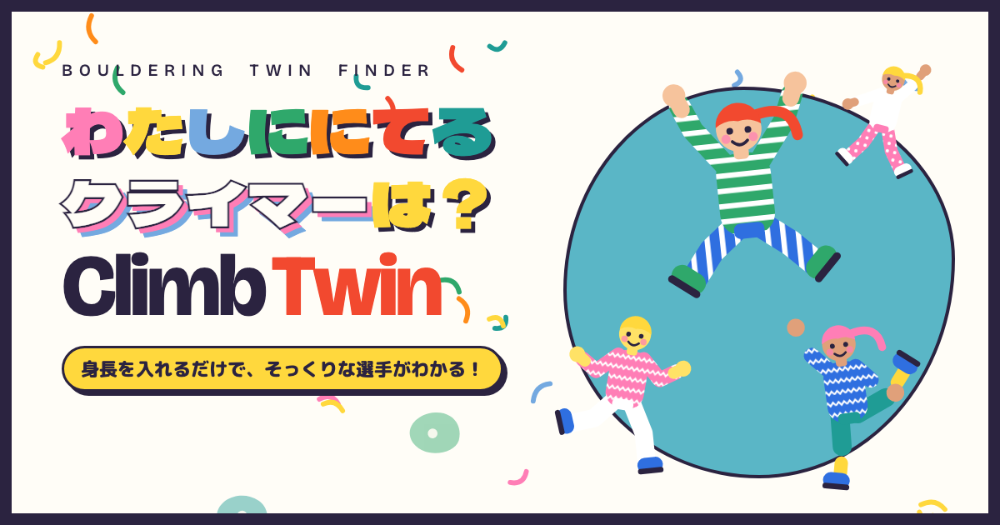

# Climb Twin 🧗 わたしににてるクライマーは？



身長（と腕の長さ）を入れるだけで、**体格がそっくりなボルダリング選手**がわかる、初心者向けのお楽しみサイトです。

### 👉 [サイトを開く](https://asukaokochi-kinako.github.io/bouldering_twin_finder/)　｜　📖 [ボルダリングの楽しみ方](https://asukaokochi-kinako.github.io/bouldering_twin_finder/guide.html)

---

## できること

### そっくりクライマー診断
- **性別・身長・腕の長さ（任意）** を入れると、体格の近い選手ベスト3を表示
- 選手ごとに「そっくり度」、身長・腕の長さの比較、得意なスタイル、紹介文、プレイ動画（YouTube検索）へのリンク
- 結果は **X / LINE / Threads / Facebook** でシェアしたり、文章をコピーしたりできます

### ボルダリングの楽しみ方（ガイドページ）
- ボルダリングの基本ルール（課題・スタート・完登）
- 応援の声かけ「ガンバ！」（押すと跳ねる **ガンバ！ボタン** つき）
- よく聞く用語集（登り方・ホールド・壁・技）
- グレード（級・段）の見方と、V・フォンテーヌとの対応表
- はじめてのジムでの持ちもの・マナー、[近くのジムを探す](https://www.google.com/maps/search/?api=1&query=%E3%83%9C%E3%83%AB%E3%83%80%E3%83%AA%E3%83%B3%E3%82%B0%E3%82%B8%E3%83%A0)ボタン
- 大会観戦の見どころ（TOP / ZONE / TRY）

## プライバシー

- 入力した身長・腕の長さは **ブラウザの中だけで計算** します。サーバーへの送信・保存は一切しません（サーバー側の処理自体がない静的サイトです）。
- シェア文に入るのは選手名とサイトのURLだけで、入力した数値は含まれません。
- 「近くのジムを探す」はGoogleマップを開くだけで、このサイトが位置情報を受け取ることはありません。

## そっくり度のしくみ

1. 身長の差を見る
2. 腕の長さが入力されていれば、**「腕の長さ − 身長」**（エイプ指数）の差も見る。ボルダリングではリーチの比率が登り方に直結するので、こちらをやや重めに評価
3. 2つの差をまとめた距離から「そっくり度（%）」を計算し、上位3人を表示

腕の長さが公表されていない選手は、比べられない分だけ少しスコアを差し引いています。

## 選手データについて

現在 **21人**（男子11人・女子10人）を収録しています。

| 項目 | 出典 |
|---|---|
| 身長 | 日本山岳・スポーツクライミング協会、IFSC、五輪公式などの公表値を優先 |
| 腕の長さ | 公式な計測値はほぼ公開されていないため、Wikipedia や [99Boulders](https://www.99boulders.com/ape-index-calculator)、[The Hangboard](https://thehangboard.com/blogs/news/ape-index-calculator) などの参考値から算出。見つからない選手（8人）は「不明」表示 |
| アイコン | 各選手の公開写真を参考に、髪型・髪色・肌の色・服の色をイラストで再現（写真そのものは使っていません） |

それぞれの出典は [`data.js`](data.js) の各選手の上にコメントで書いてあります。正確な値が見つかったら `data.js` を書き換えるだけでサイト全体に反映されます。

## 技術メモ

- HTML / CSS / JavaScript だけの静的サイト。ビルド不要、外部ライブラリなし（フォントのみ Google Fonts）
- イラスト（着ぐるみ風の人物・紙吹雪・ホールド）はすべて JavaScript で SVG を生成
- ホスティングは GitHub Pages（`main` ブランチの直下を公開）

```
index.html / style.css / script.js   診断ページ
guide.html / guide.css / guide.js    ボルダリングの楽しみ方
data.js                              選手データ（身長・腕の長さ・見た目・紹介文）
figures.js                           人物・紙吹雪のSVG生成（全ページ共通）
ogp/                                 OGP画像のもとになるページ
ogp.png / ogp-guide.png              SNSシェア用の画像
```

### ローカルで動かす

```bash
python3 -m http.server 8765
```

ブラウザで http://localhost:8765 を開きます。

### OGP画像を作り直す

ローカルサーバーを起動した状態で、Chrome のヘッドレスモードでスクリーンショットします（トップページ用の例）。

```bash
"/Applications/Google Chrome.app/Contents/MacOS/Google Chrome" --headless=new --user-data-dir="$TMPDIR/ogp-chrome" --hide-scrollbars --force-device-scale-factor=1 --window-size=1200,630 --virtual-time-budget=8000 --screenshot="$PWD/ogp.png" http://localhost:8765/ogp/ogp.html
```

ガイド用は `ogp/guide.html` → `ogp-guide.png` です。

## 注意

- 選手の身長・腕の長さは公開情報をもとにした目安値です。
- グレードの対応表はおおよそのめやすで、ジムや地域によって差があります。
- 選手名・紹介文は応援の気持ちで書いたファンメイドのコンテンツで、選手本人や所属団体とは関係ありません。
